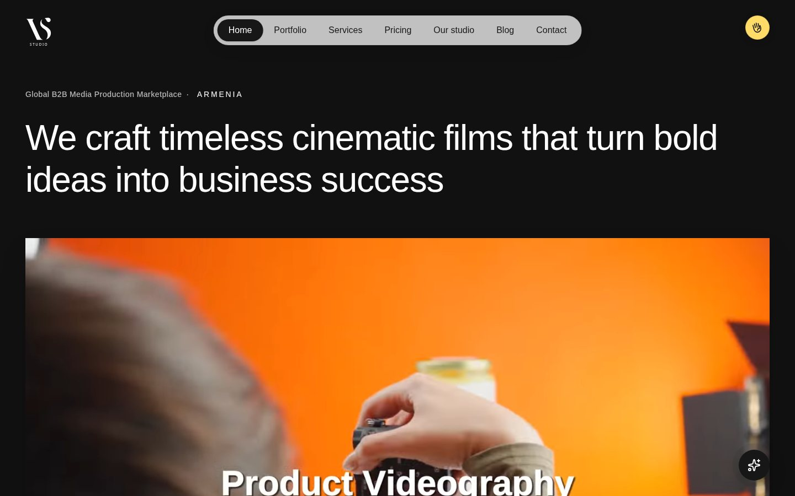
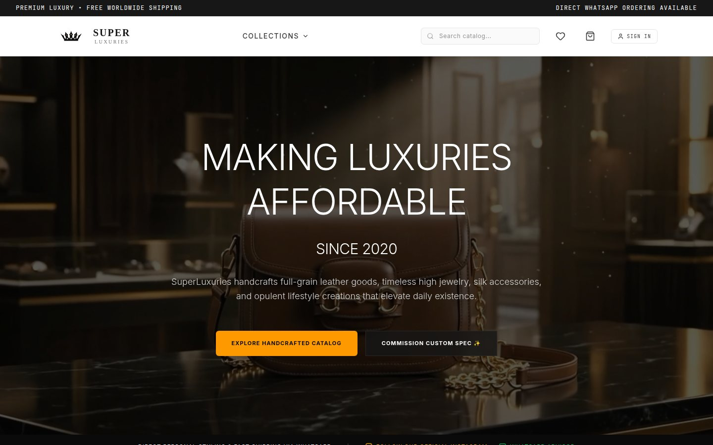

<div align="center">

<picture>
  <source media="(max-width: 767px)" srcset="./assets/hero.mobile.svg">
  
</picture>

<br /><br />

<a href="https://www.cynex.online/works"></a>
&nbsp;&nbsp;
<a href="https://github.com/Abdul-Manan-C?tab=repositories"></a>

</div>

**Founder of [CYNEX Studio](https://www.cynex.online)**<br />
Conversion-focused websites · 3D product stages · owner dashboards<br />
WhatsApp storefronts · 24/7 AI sales assistants

**Now:** shipping client platforms from Azad Kashmir<br />
Building [AUTOCORE](https://github.com/Abdul-Manan-C/autocore) v4 and the<br />
[CSSC platform](https://csscuajk.dev) at UAJK · finishing my BSc in CS

<div align="center">





</div>

## Six platforms in production

Full builds for founders, stores and agencies.<br />
Direction, design, code, deployment, DNS, email, aftercare.

<table>
  <tr>
    <td width="50%" valign="top" align="left">
      <picture>
        <source media="(max-width: 767px)" srcset="./assets/screens/m/laxitech.jpg">
        
      </picture><br />
      <b><a href="https://laxitech.com/">Laxitech</a></b> <code>laxitech.com</code><br />
      3D MacBook stage with WebGL aurora lighting.
    </td>
    <td width="50%" valign="top" align="left">
      <picture>
        <source media="(max-width: 767px)" srcset="./assets/screens/m/vixion.jpg">
        
      </picture><br />
      <b><a href="https://www.vixion.studio/">Vixion Studio</a></b> <code>vixion.studio</code><br />
      Dark-to-light scroll; AI concierge to WhatsApp.
    </td>
  </tr>
  <tr>
    <td valign="top" align="left">
      <picture>
        <source media="(max-width: 767px)" srcset="./assets/screens/m/movix.jpg">
        
      </picture><br />
      <b><a href="https://www.movixstudio.com/">Movix Studio</a></b> <code>movixstudio.com</code><br />
      Instant HD showreel; indexed on Google in 20 min.
    </td>
    <td valign="top" align="left">
      <picture>
        <source media="(max-width: 767px)" srcset="./assets/screens/m/commerce-lions.jpg">
        
      </picture><br />
      <b><a href="https://www.commercelions.com/">Commerce Lions</a></b> <code>commercelions.com</code><br />
      Education portal with protected member accounts.
    </td>
  </tr>
  <tr>
    <td valign="top" align="left">
      <picture>
        <source media="(max-width: 767px)" srcset="./assets/screens/m/super-luxuries.jpg">
        
      </picture><br />
      <b><a href="https://www.superluxuries.store/">Super Luxuries</a></b> <code>superluxuries.store</code><br />
      Dubai + London boutique; WhatsApp checkout.
    </td>
    <td valign="top" align="left">
      <picture>
        <source media="(max-width: 767px)" srcset="./assets/screens/m/mac-vision.jpg">
        
      </picture><br />
      <b><a href="https://www.macvision.store/">Mac Vision</a></b> <code>macvision.store</code><br />
      Apple reseller; founder-locked owner dashboard.
    </td>
  </tr>
</table>

Case studies, pricing and process: [cynex.online/works](https://www.cynex.online/works)

## Toolbelt

<picture>
  <source media="(max-width: 767px)" srcset="./assets/stack.mobile.svg">
  
</picture>

<sub>Official brand marks, grouped by purpose.</sub>

## Selected work

<table>
  <tr>
    <td width="50%" valign="top" align="left">
      <picture>
        <source media="(max-width: 767px)" srcset="./assets/cards/repo-autocore.mobile.svg">
        
      </picture>
    </td>
    <td width="50%" valign="top" align="left">
      <picture>
        <source media="(max-width: 767px)" srcset="./assets/cards/repo-cynex-portfolio.mobile.svg">
        
      </picture>
    </td>
  </tr>
  <tr>
    <td valign="top" align="left">
      <picture>
        <source media="(max-width: 767px)" srcset="./assets/cards/repo-nullshield.mobile.svg">
        
      </picture>
    </td>
    <td valign="top" align="left">
      <picture>
        <source media="(max-width: 767px)" srcset="./assets/cards/repo-ironcore.mobile.svg">
        
      </picture>
    </td>
  </tr>
  <tr>
    <td valign="top" align="left">
      <picture>
        <source media="(max-width: 767px)" srcset="./assets/cards/repo-bus-reservation-system.mobile.svg">
        
      </picture>
    </td>
    <td valign="top" align="left">
      <picture>
        <source media="(max-width: 767px)" srcset="./assets/cards/repo-flamehouse.mobile.svg">
        
      </picture>
    </td>
  </tr>
</table>

## Security practice

Offensive tooling and hands-on practice, not theory.

- **[AUTOCORE](https://github.com/Abdul-Manan-C/autocore)** — recon → enumeration → AI analysis →<br />CVE lookup → report, chained into one run. Detects the OS and works on<br />Kali, Fedora, Arch, Debian, Termux and NetHunter.
- **TryHackMe** — working through the practical tracks:<br />Basic Pentesting, Metasploit and Ninja Skills.
- **Method** — read the code, map the trust boundaries, then automate<br />the boring parts. The tools should make you faster, not reckless.

<a href="https://tryhackme.com/p/mananhanif01" target="_blank"></a>

## Every public repository

Straight from the GitHub API, refreshed every morning.

<!-- AUTO:REPOS:START -->
| Repository | What it is | Stack | ★ | Last push |
|---|---|---|---|---|
| **[autocore](https://github.com/Abdul-Manan-C/autocore)** | Automated pentest recon & enumeration orchestrator — bash v3 and an AI-powered Python TUI v4 with auto OS detection. | bash · python · textual · llm | 5 | 8mo ago |
| **[Bus-Reservation-System](https://github.com/Abdul-Manan-C/Bus-Reservation-System)** | Console app — add buses, reserve seats, print reports, file-based storage, no database. | c++ · file storage | 3 | 8mo ago |
| **[ironcore](https://github.com/Abdul-Manan-C/ironcore)** | IronCore Gym — fitness site with dashboard, pricing, programmes and trainers. | html · css · js | 3 | 8mo ago |
| **[CYNEX-Portfolio](https://github.com/Abdul-Manan-C/CYNEX-Portfolio)** | Cyber-themed portfolio: terminal simulation, intrusion game and a live system HUD. | react · vite · typescript · tailwind | 3 | 4mo ago |
| **[nullshield](https://github.com/Abdul-Manan-C/nullshield)** | NullShield Security — pentest, SOC monitoring and defensive hardening services site. | html · css · js | 2 | 8mo ago |
| **[portfolio](https://github.com/Abdul-Manan-C/portfolio)** | Personal portfolio — 3D layered multi-page build with timeline, skills and project lab. | html · css · js | 2 | 8mo ago |
| **[super-marketing](https://github.com/Abdul-Manan-C/super-marketing)** | Super Marketing Pvt. Ltd — real-estate agency site with property listings, services and WhatsApp contact. | html · css · js | 2 | 8mo ago |
| **[Abdul-Manan-C](https://github.com/Abdul-Manan-C/Abdul-Manan-C)** | This profile — README plus the generator that renders its own console art. | markdown · python | 2 | today |
| **[MY_HTML-PRACTICE](https://github.com/Abdul-Manan-C/MY_HTML-PRACTICE)** | ChatGPT-style blog UI — front-end practice build. | html · css · js | 1 | 2y ago |
| **[mac-vision](https://github.com/Abdul-Manan-C/mac-vision)** | Mac Vision — Apple & tech reseller store template (demo brand). | html · css · js | 1 | 8mo ago |
| **[novamind-ai](https://github.com/Abdul-Manan-C/novamind-ai)** | NovaMind AI — SaaS landing template (demo brand, front-end showcase). | html · css · js | 1 | 8mo ago |
| **[flamehouse](https://github.com/Abdul-Manan-C/flamehouse)** | Restaurant site template with a one-file token theme system (restaurant, gym, cafe). | html · css · js | 1 | 8mo ago |
| **[movix](https://github.com/Abdul-Manan-C/movix)** | Movix Studio — premium video agency site, static build. | html · css · js | 0 | 7mo ago |
| **[movixstudio](https://github.com/Abdul-Manan-C/movixstudio)** | Boutique video-editing agency site — hooks, stories and results. | vite · typescript | 0 | 4mo ago |
<!-- AUTO:REPOS:END -->

## Activity

<picture>
  <source media="(max-width: 767px)" srcset="./assets/activity.mobile.svg">
  
</picture>

## How this README is built

A README cannot run JavaScript, but it can load SVG images —<br />
and an SVG carries its own CSS animation, embedded fonts and<br />
counters. Every visual is drawn by one script from real data,<br />
and GitHub Actions redraws it every morning.

```text
GitHub API ──┐
contributions┤
             └→ build_profile_art.py
              ├→ hero.svg  cards/
              ├→ activity.svg  stack.svg
              └→ repo table
sites ─→ cdp_capture.mjs ─→ screens/
         └→ shrink_screens.py → screens/m/
```

No badge wall, no third-party card service, no manual editing —<br />
every number above is read from GitHub at build time, and the brand<br />
marks come from the official Simple Icons set.

## Connect

<div align="center">

<a href="https://github.com/Abdul-Manan-C"></a>
&nbsp;
<a href="https://www.linkedin.com/in/ch-manan-343742370"></a>
&nbsp;
<a href="https://www.instagram.com/chmanan_524"></a>
&nbsp;
<a href="https://www.fiverr.com/abdulmanan2233"></a>
&nbsp;
<a href="https://tryhackme.com/p/mananhanif01"></a>
&nbsp;
<a href="https://wa.me/923118873637"></a>
&nbsp;
<a href="mailto:chmanan524@gmail.com"></a>

<br /><br />

[chmanan524@gmail.com](mailto:chmanan524@gmail.com) · [+92 311 8873637](https://wa.me/923118873637) · [cynex.online](https://www.cynex.online)

<br /><br />

<sub>© 2026 · Abdul Manan (CH Manan) · CYNEX Studio, Azad Kashmir</sub>

</div>
