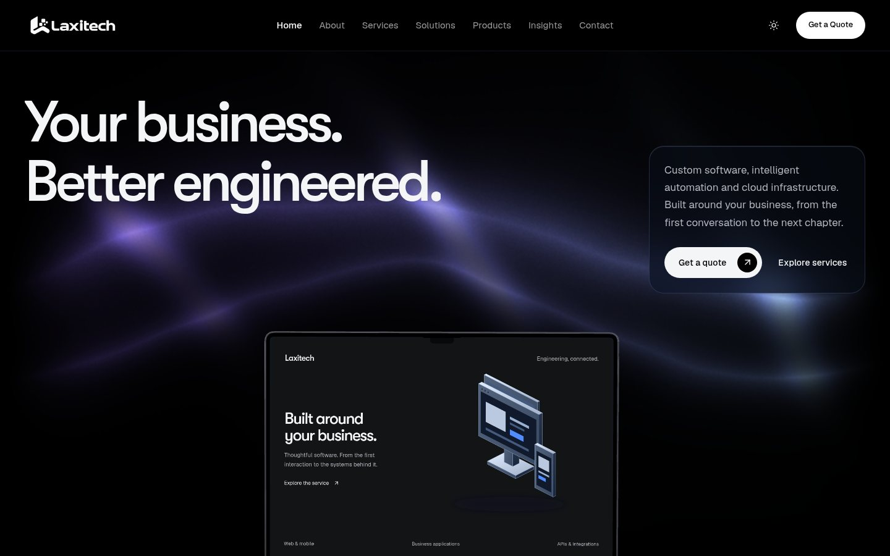
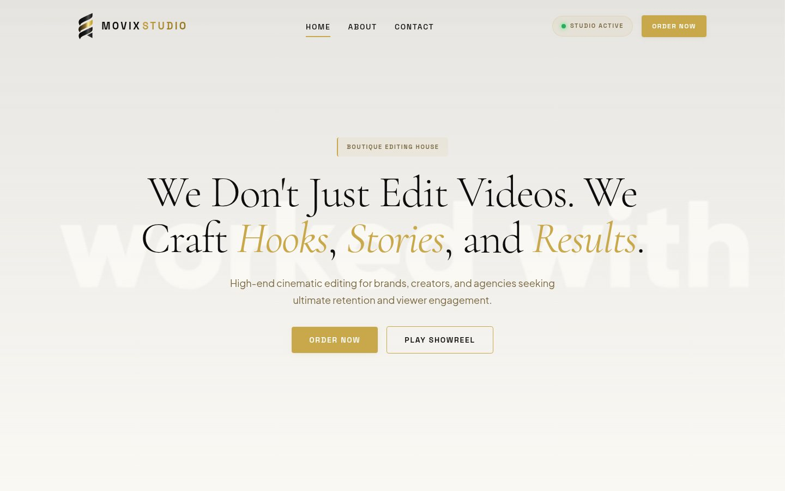
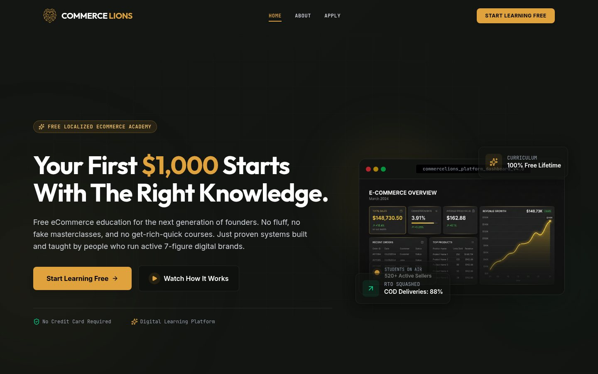
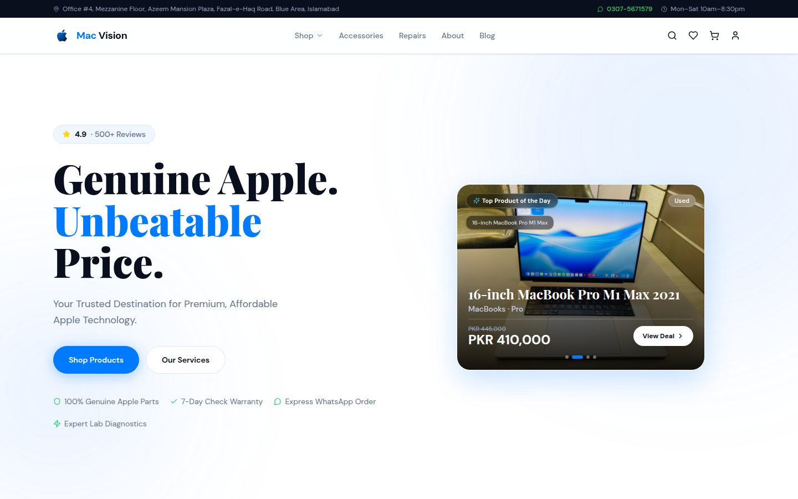

<div align="center">


</div>

<div align="center">

**Founder of [CYNEX Studio](https://cynex.online)** — conversion-focused websites, 3D product stages, owner dashboards, WhatsApp storefronts and 24/7 AI sales assistants.

**Currently:** shipping client platforms from Azad Kashmir · building [AUTOCORE](https://github.com/Abdul-Manan-C/autocore) v4 · building the [Cyber Security Students Club](https://csscuajk.dev) platform at UAJK · finishing my BSc in Computer Science

Motivated by Islam. Linux daily driver: Fedora 43 with Kali in Distrobox.

</div>

---

<table>
  <tr>
    <td width="33%" align="center"><a href="https://cynex.online/works"></a></td>
    <td width="33%" align="center"><a href="https://github.com/Abdul-Manan-C/autocore"></a></td>
    <td width="33%" align="center"><a href="https://cynex.online"></a></td>
  </tr>
</table>

## Six platforms in production

I work directly with founders, stores and agencies in the US, UK, UAE and Saudi Arabia. Every build is end-to-end — direction, design, custom code, deployment, DNS, business email and post-launch care — not a template with the logo swapped.

<table>
  <tr>
    <td width="50%" align="center" valign="top">
      <a href="https://laxitech.com/"></a><br />
      <b><a href="https://laxitech.com/">Laxitech</a></b><br />
      3D MacBook hero stage with WebGL aurora lighting, isometric engineering illustrations, Cloud VPS / GXMail / GXNotify, obsidian + ivory themes
    </td>
    <td width="50%" align="center" valign="top">
      <a href="https://www.vixion.studio/"></a><br />
      <b><a href="https://www.vixion.studio/">Vixion Studio</a></b><br />
      Creative studio built from a single visual reference — dark-to-light scroll transition, package comparison, custom domain email, AI concierge that hands leads to WhatsApp
    </td>
  </tr>
  <tr>
    <td align="center" valign="top">
      <a href="https://www.movixstudio.com/"></a><br />
      <b><a href="https://www.movixstudio.com/">Movix Studio</a></b><br />
      Video production agency platform — instant HD showreel without buffering, custom domain, indexed on Google within 20 minutes of launch
    </td>
    <td align="center" valign="top">
      <a href="https://www.commercelions.com/"></a><br />
      <b><a href="https://www.commercelions.com/">Commerce Lions</a></b><br />
      Education and mentorship portal — one-click Google Sign-In, protected member database, SEO-ready pages, WhatsApp cohort onboarding
    </td>
  </tr>
  <tr>
    <td align="center" valign="top">
      <a href="https://www.superluxuries.store/"></a><br />
      <b><a href="https://www.superluxuries.store/">Super Luxuries</a></b><br />
      Dubai + London luxury boutique — role-based staff accounts, cloud media hosting, WhatsApp personal-shopper checkout
    </td>
    <td align="center" valign="top">
      <a href="https://www.macvision.store/"></a><br />
      <b><a href="https://www.macvision.store/">Mac Vision</a></b><br />
      Apple and tech retail store — founder-locked dashboard, one-click bulk price adjustment, background uploads, itemized WhatsApp orders
    </td>
  </tr>
</table>

Delivery details and case studies: [cynex.online/works](https://cynex.online/works)

## Toolbelt

<div align="center">


</div>

## Selected work

<table>
  <tr>
    <td width="50%" align="center" valign="top">
      <a href="https://github.com/Abdul-Manan-C/autocore"></a>
    </td>
    <td width="50%" align="center" valign="top">
      <a href="https://github.com/Abdul-Manan-C/CYNEX-Portfolio"></a>
    </td>
  </tr>
  <tr>
    <td align="center" valign="top">
      <a href="https://github.com/Abdul-Manan-C/nullshield"></a>
    </td>
    <td align="center" valign="top">
      <a href="https://github.com/Abdul-Manan-C/ironcore"></a>
    </td>
  </tr>
  <tr>
    <td align="center" valign="top">
      <a href="https://github.com/Abdul-Manan-C/Bus-Reservation-System"></a>
    </td>
    <td align="center" valign="top">
      <a href="https://github.com/Abdul-Manan-C/flamehouse"></a>
    </td>
  </tr>
</table>

## Security practice

My security work is offensive tooling and hands-on practice, not theory.

- **[AUTOCORE](https://github.com/Abdul-Manan-C/autocore)** — recon → enumeration → AI analysis → CVE lookup → report, chained into one run. It detects the OS and works on Kali, Fedora, Arch, Debian, Termux and NetHunter.
- **TryHackMe** — working through the practical tracks: Basic Pentesting, Metasploit, Ninja Skills.
- **Method** — read the code, map the trust boundaries, then automate the boring parts. The tools should make you faster, not make you reckless.

<a href="https://tryhackme.com/p/mananhanif01" target="_blank"></a>

## Everything public I have shipped

Every public repository under my own account, listed straight from the GitHub API and refreshed every morning.

<!-- AUTO:REPOS:START -->
| Repository | What it is | Stack | ★ | Last push |
|---|---|---|---|---|
| **[Abdul-Manan-C](https://github.com/Abdul-Manan-C/Abdul-Manan-C)** | This profile — README plus the generator that renders its own console art. | markdown · python | 2 | today |
| **[CYNEX-Portfolio](https://github.com/Abdul-Manan-C/CYNEX-Portfolio)** | Cyber-themed portfolio: terminal simulation, intrusion game and a live system HUD. | react · vite · typescript · tailwind | 3 | 4mo ago |
| **[movixstudio](https://github.com/Abdul-Manan-C/movixstudio)** | Boutique video-editing agency site — hooks, stories and results. | vite · typescript | 0 | 4mo ago |
| **[movix](https://github.com/Abdul-Manan-C/movix)** | Movix Studio — premium video agency site, static build. | html · css · js | 0 | 7mo ago |
| **[super-marketing](https://github.com/Abdul-Manan-C/super-marketing)** | Super Marketing Pvt. Ltd — real-estate agency site with property listings, services and WhatsApp contact. | html · css · js | 2 | 8mo ago |
| **[ironcore](https://github.com/Abdul-Manan-C/ironcore)** | IronCore Gym — fitness site with dashboard, pricing, programmes and trainers. | html · css · js | 3 | 8mo ago |
| **[portfolio](https://github.com/Abdul-Manan-C/portfolio)** | Personal portfolio — 3D layered multi-page build with timeline, skills and project lab. | html · css · js | 2 | 8mo ago |
| **[flamehouse](https://github.com/Abdul-Manan-C/flamehouse)** | Restaurant site template with a one-file token theme system (restaurant, gym, cafe). | html · css · js | 1 | 8mo ago |
| **[nullshield](https://github.com/Abdul-Manan-C/nullshield)** | NullShield Security — pentest, SOC monitoring and defensive hardening services site. | html · css · js | 2 | 8mo ago |
| **[novamind-ai](https://github.com/Abdul-Manan-C/novamind-ai)** | NovaMind AI — SaaS landing template (demo brand, front-end showcase). | html · css · js | 1 | 8mo ago |
| **[mac-vision](https://github.com/Abdul-Manan-C/mac-vision)** | Mac Vision — Apple & tech reseller store template (demo brand). | html · css · js | 1 | 8mo ago |
| **[Bus-Reservation-System](https://github.com/Abdul-Manan-C/Bus-Reservation-System)** | Console app — add buses, reserve seats, print reports, file-based storage, no database. | c++ · file storage | 3 | 8mo ago |
| **[autocore](https://github.com/Abdul-Manan-C/autocore)** | Automated pentest recon & enumeration orchestrator — bash v3 and an AI-powered Python TUI v4 with auto OS detection. | bash · python · textual · llm | 5 | 8mo ago |
| **[MY_HTML-PRACTICE](https://github.com/Abdul-Manan-C/MY_HTML-PRACTICE)** | ChatGPT-style blog UI — front-end practice build. | html · css · js | 1 | 2y ago |
<!-- AUTO:REPOS:END -->

## Activity

<div align="center">



</div>

<div align="center">


</div>

## This README builds itself

A GitHub README cannot run JavaScript, but it can load SVG images — and an SVG carries its own CSS animations, embedded fonts and counters. So every visual above is drawn by one script from real data, and GitHub Actions redraws it every morning.

```text
GitHub REST API ─┐
                 ├─→ scripts/build_profile_art.py ─→ assets/hero.svg
contributions ───┘                              ├─→ assets/cards/*.svg
                                                ├─→ assets/activity.svg
live platforms ─→ scripts/cdp_capture.mjs ─────┴─→ assets/screens/*.jpg
                                                ├─→ assets/stack.svg
                                                └─→ the repository table above
```

No badge wall, no third-party card service, no manual editing — the numbers in the console, the tiles, the chart and the table are all read from GitHub at build time.

## Connect

<div align="center">

[cynex.online](https://cynex.online) · [GitHub](https://github.com/Abdul-Manan-C) · [LinkedIn](https://www.linkedin.com/in/ch-manan-343742370) · [TryHackMe](https://tryhackme.com/p/mananhanif01) · [Instagram](https://www.instagram.com/chmanan_524) · [Fiverr](https://www.fiverr.com/abdulmanan2233) · [chmanan524@gmail.com](mailto:chmanan524@gmail.com) · [+92 311 8873637](https://wa.me/923118873637)

</div>

<div align="center">

*© 2026 · Abdul Manan (CH Manan) · CYNEX Studio, Azad Kashmir*

This profile renders itself — the console art, the cards, the chart and the repository table are generated by `scripts/build_profile_art.py` and refreshed daily by GitHub Actions.

</div>
